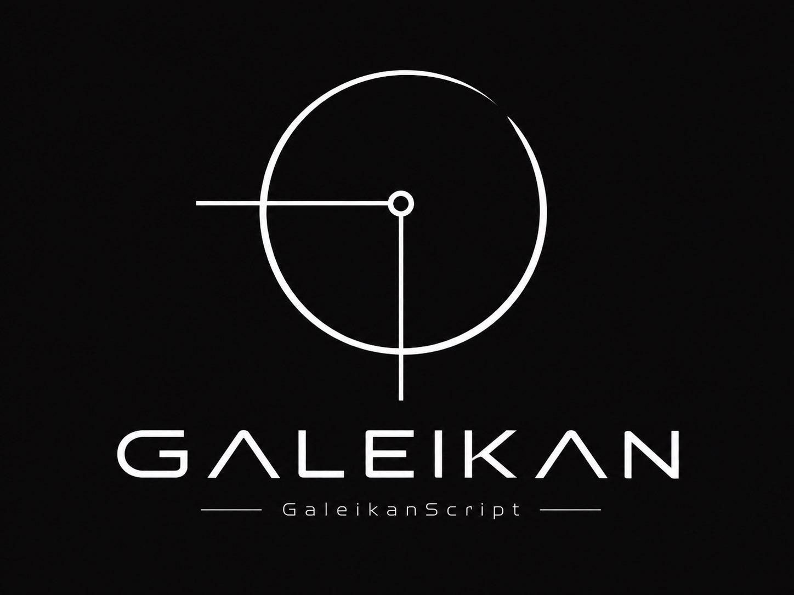
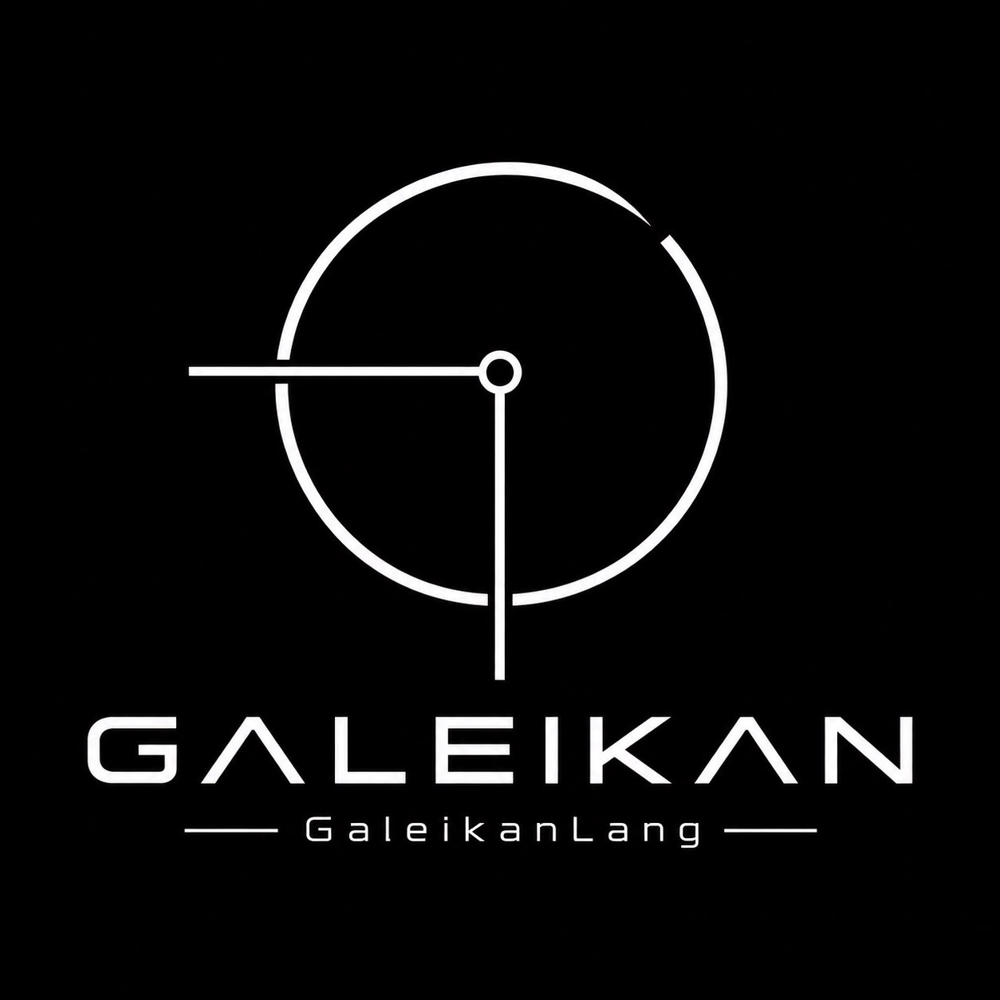

<p align="center">
  
</p>

# Galeikan

**One language for fast experiments and native research tools.** Galeikan combines an interpreter, a bytecode VM, and an x86-64 native compiler around the same source syntax. It is built for binary inspection, reproducible security research, and automation.

[](https://github.com/GaleikanOrg/Galeikan/releases)


[](https://marketplace.visualstudio.com/items?itemName=galeikan.galeikan-language)

**Explore:** [Download](https://github.com/GaleikanOrg/Galeikan/releases) · [Quickstart](docs/quickstart.md) · [Technical overview](docs/technical.md) · [Examples](examples/) · [VS Code extension](https://marketplace.visualstudio.com/items?itemName=galeikan.galeikan-language)

> [!IMPORTANT]
> Galeikan is a **0.1.0 development preview**. The native compiler supports a smaller subset than the interpreter and VM. Downloads are unsigned, and declared effects are not an operating-system sandbox.

## Start in a few minutes

Download the **Galeikan** installer for Windows x64 or the Debian 13 amd64 package from the [current release](https://github.com/GaleikanOrg/Galeikan/releases/tag/v0.1.0-preview1.1). The Windows installer adds `galeikan` to your user PATH; open a **new terminal** after setup. The Debian package installs the CLI at `/usr/bin/galeikan`.

| Download | Current artifact |
| :--- | :--- |
| Windows x64 | [Galeikan setup `.exe`](https://github.com/GaleikanOrg/Galeikan/releases/download/v0.1.0-preview1.1/Galeikan-0.1.0-preview1.1-windows-x64-setup.exe) |
| Debian 13 amd64 | [Galeikan `.deb`](https://github.com/GaleikanOrg/Galeikan/releases/download/v0.1.0-preview1.1/galeikan_0.1.0.preview1_amd64.deb) |
| Visual Studio Code | [Marketplace extension](https://marketplace.visualstudio.com/items?itemName=galeikan.galeikan-language) · [VSIX download](https://github.com/GaleikanOrg/Galeikan/releases/download/v0.1.0-preview1.1/galeikan-language-0.1.0.vsix) |

The release also includes [SHA-256 checksums](https://github.com/GaleikanOrg/Galeikan/releases/download/v0.1.0-preview1.1/SHA256SUMS.txt). The Debian and VSIX artifacts retain their Preview 1 filenames in the Windows installer update.

The commands below use examples from this repository. Clone it first if you installed a binary package:

```sh
git clone https://github.com/GaleikanOrg/Galeikan.git
cd Galeikan
galeikan check examples/inspect_script.gaks
galeikan run examples/inspect_script.gaks
galeikan run examples/inspect_script.gaks --engine vm
```

The script inspects an eight-byte snapshot, counts two zero bytes, and prints its SHA-256 digest. The AST interpreter and VM should report the same result:

```text
bytes:
8
zero bytes:
2
sha256:
b591bdb96970076886ee758f1aba4648db7b0c541fc869b9878af76c3aa92659
```

To produce and run a bytecode bundle, then try the native subset:

```sh
galeikan build examples/inspect_script.gaks
galeikan exec examples/inspect_script.gakb
galeikan compile examples/native_scalar.gak
```

`compile` requires a suitable host x86-64 GCC toolchain. It emits a Windows PE `.exe` on Windows or a Linux ELF `.native` executable on Linux. See the [quickstart](docs/quickstart.md) for effect grants, arguments, and Python interop.

## One syntax, two ways to work

| GaleikanScript · `.gaks` | GaleikanLang · `.gak` |
| :--- | :--- |
|  |  |
| Run a source file directly while exploring a dataset, format, or workflow. The VM is available with `--engine vm`. | Compile supported constructs into a native x86-64 executable for Windows or Linux. |
| Try [`examples/inspect_script.gaks`](examples/inspect_script.gaks). | Try [`examples/native_scalar.gak`](examples/native_scalar.gak). |

The extensions **describe intended use, not different languages**. Both `.gak` and `.gaks` have the same syntax and may be checked, interpreted, bundled, or compiled when the native backend supports the program. Installers and packages use the product name **Galeikan**.

## What the preview can do

| Workflow | Concrete capability | Start here |
| :--- | :--- | :--- |
| Inspect bytes | Bounded `Source` snapshots, views, typed `Observation` values, hashes, and byte-pattern searches | [`inspect_script.gaks`](examples/inspect_script.gaks), [`masked_hunt.gak`](examples/masked_hunt.gak) |
| Read executable formats | Inspect PE and ELF headers, sections, symbols, dependencies, imports, exports, and relocations | [`section_report.gak`](examples/section_report.gak), [`entry_linear.gak`](examples/entry_linear.gak) |
| Disassemble | Decode bounded x86 instruction ranges and inspect control-flow-oriented views | [`disassemble.gak`](examples/disassemble.gak) |
| Record research | Build findings with source lineage, export a case, and verify its hashes without rerunning the original program | [`case_report.gak`](examples/case_report.gak), [`case_lineage.gak`](examples/case_lineage.gak) |
| Automate access | Declare file, network, process-inspection, or Python effects in source and grant them at launch | [`tcp_probe.gak`](examples/tcp_probe.gak), [`process_regions.gak`](examples/process_regions.gak) |
| Reuse code | Import project-local modules with `import helper` or `from helper import name`; lock offline local packages (no hosted registry yet) | [`package_demo`](examples/package_demo/) |
| Work with Python | Call project-local Python modules from Galeikan, or call Galeikan functions through the optional Python bridge | [`interop/main.gak`](examples/interop/main.gak), [`python/galeikan_bridge`](python/galeikan_bridge/) |

Here is the core of the runnable [snapshot script](examples/inspect_script.gaks):

```galeikan
import std.binary
import std.iter

let sample: Source = binary.snapshot(binary.from_hex("47 41 4b 00 90 90 00 01"))
var zero_bytes: i64 = 0

for offset in iter.range(binary.size(sample)) {
    let byte: Observation = binary.deep(sample, offset, "u8")
    if binary.value(byte) == 0 {
        zero_bytes = zero_bytes + 1
    }
}

print zero_bytes
print binary.sha256(sample)
```

`Source` identifies the captured bytes; `Observation` preserves the decoded value and its origin. This model helps connect a finding to the input that produced it.

## Python without rewriting your toolkit

Galeikan can import a project-local Python module under `py.*`. The source must declare `python.exec`, and the invocation must grant a Python executable. The checked-in interop example combines a Galeikan helper with a Python `double` function:

```sh
# Windows
galeikan run examples/interop/main.gak --allow-python python

# Linux
galeikan run examples/interop/main.gak --allow-python python3
```

The example prints `44`. The bridge exchanges bounded typed values (`i64`, `u64`, `bool`, strings, bytes, and homogeneous lists); it does not embed CPython or pass arbitrary Python objects. Supported native Galeikan programs can use the process bridge too, provided Python and the imported `.py` files are present in their expected relative locations. Python can call Galeikan functions through the optional [`galeikan_bridge`](python/galeikan_bridge/) package, including a persistent session for repeated calls.

## Explicit effects and research boundaries

An effectful operation needs both a declaration in the source and a matching launch grant. For example, a file-reading program declares `requires { file.read }` and runs with `--allow-read <directory>`. Network and process access have separate grants. `galeikan check` checks source without executing its effects.

These checks make access visible and bounded, **not isolated**. Python modules run with their normal OS permissions; Galeikan does not yet provide a complete sandbox for untrusted source. Format metadata and hardening signals are observations, not malware verdicts or proof of runtime protection. The [technical overview](docs/technical.md) describes the current implementation and limits.

## Build and explore the source

The main implementation is in Rust, with C runtime components and a small x86-64 assembly stage-0 retained for bootstrap research. Build the CLI with:

```sh
cargo build --release
```

| Path | Purpose |
| :--- | :--- |
| [`src/`](src/) | Frontend, execution engines, native backend, and standard modules |
| [`stage0/`](stage0/) | Assembly bootstrap experiment |
| [`examples/`](examples/) | Runnable language and research examples |
| [`tests/`](tests/) | Language and runtime checks |
| [`python/`](python/) | Optional Python-to-Galeikan bridge |
| [`editors/vscode/galeikan/`](editors/vscode/galeikan/) | Syntax highlighting and Galeikan Eclipse theme |
| [`scripts/`](scripts/) · [`packaging/`](packaging/) | Windows and Debian release packaging |

For a larger worked problem, try the [triple-capture recovery challenge](docs/triple-capture-challenge.md). Report reproducible issues through [GitHub Issues](https://github.com/GaleikanOrg/Galeikan/issues) with the source file, command, platform, and observed output.
